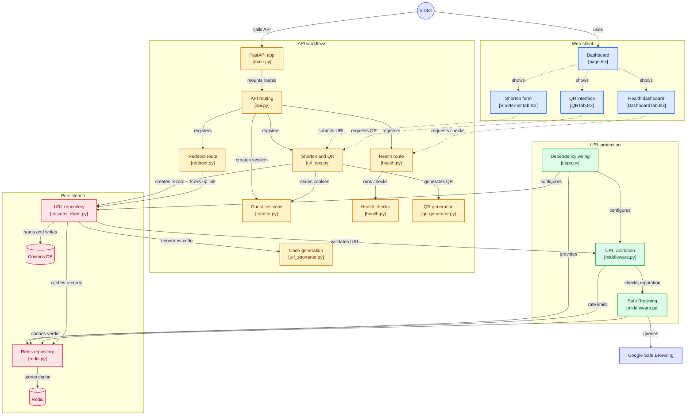

# URL Magic

URL Magic is a cloud-native URL shortener, QR code generator, and concurrent URL health checker built on FastAPI, Next.js, and the Microsoft Azure ecosystem (Azure Functions, Cosmos DB, Redis, and Static Web Apps).

## Architecture



---

## Project Structure

- [`api/`](api/) - FastAPI backend running on Azure Functions (Python 3.12+).
- [`client/`](client/) - Next.js dashboard and frontend.
- [`infra/`](infra/) - Terraform configuration for Azure cloud resources.
- [`docs/`](docs/) - Architecture diagrams, design docs, and guides.
- [`Makefile`](Makefile) - Local development orchestration targets.

---

## Prerequisites

Ensure you have the following installed on your machine:

1. **Docker Engine / Docker Desktop** (running)
2. **Python 3.12+** and [`uv`](https://docs.astral.sh/uv/)
3. **Node.js**:
   - **Node 20** for Azure Functions Core Tools
   - **Node 24** for Next.js & Azure Static Web Apps CLI
   - Recommended: [`nvm`](https://github.com/nvm-sh/nvm) to easily switch Node versions
4. **Global CLIs**:
   - Azure Functions Core Tools v4 (`npm install -g azure-functions-core-tools@4 --unsafe-perm true`) - make sure you use node 20 to download this tool
   - Azure Static Web Apps CLI (`npm install -g @azure/static-web-apps-cli`)
5. **GNU Make**

---

## Quickstart (Newcomer Local Setup)

### 1. Install Dependencies
Run the top-level setup target to sync python packages via `uv` and install client dependencies via `npm`:
```bash
make setup
```

### 2. Configure Environment Settings
The backend requires configuration files for Azure Functions and local services. Templates are provided in `api/`:

```bash
# Copy Function host settings template (remove the 'example.' prefix)
cp api/example.local.settings.json api/local.settings.json

# Copy environment variables template
cp api/.env.example api/.env
```
> The default values in `example.local.settings.json` and `.env.example` are pre-configured to connect directly with the local Docker emulator services. Only `SAFE_BROWSING` uses actual Safe Browsing API key, so make sure you have that to check the URL against Google service.

### 3. Start Local Data Services
Launch the background Docker containers (Redis, Cosmos DB Emulator, and Azurite):
```bash
make data
```
> This starts or creates `redis-local` (port 6379), `cosmos-emulator` (port 8081), and `azurite-local` (ports 10000–10002).

### 4. Run the Application
Open **three separate terminal windows** to run the services:

- **Terminal 1 (Backend API):**
  ```bash
  make api
  ```
  *Runs Azure Functions host on `http://localhost:7071` (Node 20).*
  *(Fallback: if Core Tools is unavailable, run `cd api && uv run uvicorn main:app --reload --port 8000`)*

- **Terminal 2 (Frontend Client):**
  ```bash
  make client
  ```
  *Runs the Next.js dev server on `http://localhost:3000` (Node 24).*

- **Terminal 3 (SWA Proxy Emulator):**
  ```bash
  make swa
  ```
  *Runs Azure Static Web Apps CLI proxying frontend and backend at `http://localhost:4280` (Node 24).*

---

## Using the Application

Open your browser to:
👉 **[http://localhost:4280](http://localhost:4280)**

All requests through port `4280` automatically proxy frontend pages and `/api/v1` backend endpoints.

---

## Quick API Smoke Test

To verify the backend API endpoints directly from a terminal:

```bash
# 1. Create a guest session (stores session cookies)
curl -i -c cookies.txt -b cookies.txt http://localhost:4280/api/v1/session/guest

# 2. Shorten a URL
curl -b cookies.txt -H "Content-Type: application/json" \
  -d '{"url":"https://example.com","ttl":3600}' \
  http://localhost:4280/api/v1/shorten

# 3. Generate a QR code
curl -H "Content-Type: application/json" \
  -d '{"url":"https://example.com"}' \
  -o example-qr.png \
  http://localhost:4280/api/v1/qr

# 4. Check URL health
curl -H "Content-Type: application/json" \
  -d '{"urls":["https://example.com"]}' \
  http://localhost:4280/api/v1/health
```

---

## Stopping Local Services

When finished developing, stop the local Docker containers:
```bash
make stop
```
